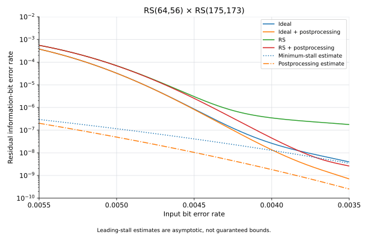

# Product code experiments

## Quick start

We provide two CLI tools for RS product code experiments: `rs-product-test` and
`rs-product-monte-carlo`. Build them with the `experimental` preset:

```bash
cmake --preset experimental
cmake --build --preset experimental
```

## Testing stall patterns and miscorrections

`rs-product-test sample` plants a verified error scenario, adds exactly `k` uniformly
selected distinct bit flips, and saves complete error samples independently of
testing:

For $RS(256,224)\times RS(175,173)$, each block contains
$256\times175\times8=358{,}400$ bits. A bit-error rate of
$5\times10^{-3}$ corresponds to exactly $1,792$ random flips per block:

```bash
build/experimental-preset/rs-product-test sample stall \
  --strong-n 256 --strong-k 224 --weak-n 175 --weak-k 173 \
  --random-bits 1792 --samples 100 --seed 42 > stall.json
```

Replace `stall` with another
scenario below, or `none` for background noise alone. For scenarios with
protected miscorrection columns, the same count is distributed over fewer
eligible bits, giving a slightly higher background rate in those columns that
remain eligible.

Predefined error patterns are:

- `none` meaning no special error patterns
- `stall` meaning $\left(\frac{n_1-k_1}{2}+1\right)\times \left(\frac{n_2-k_2}{2}+1\right)$ submatrix full of errors formed by random rows/columns
- `miscorrection` meaning a single miscorrection of strong component
- `mixed` meaning a single miscorrection plus errors on another strong component aligned with the miscorrection witness positions
- `miscorrection-stall` meaning miscorrection at one strong component and a stall pattern elsewhere
- `two-miscorrections` meaning two miscorrections of strong component

Use `--strong-n`, `--strong-k`, `--weak-n`, and `--weak-k` to change
dimensions, by default $RS(256, 224)\times RS(175, 173)$ is used. Planted scenarios require weak redundancy 2 and strong redundancy
at least 4. Selected columns include parity columns and are randomized per sample.

`stall.json` can then be inspected. The tool uses an all-zero transmitted
codeword; each sample's `error_hex` contains the erroneous block as a hex string
of row-major Cantor-coordinate bytes, including parity positions.

Use `rs-product-test test` to decode the erroneous blocks with postprocessing:

```bash
build/experimental-preset/rs-product-test test stall.json > results.json
```

Start with `--random-bits 0` to inspect the planted mechanisms, then sweep the
noise count and seed. Random flips exclude planted strong-miscorrection columns
(one column for `miscorrection`, `mixed`, and `miscorrection-stall`; two for
`two-miscorrections`). Their initial strong-decoder miscorrections are therefore
preserved.

In `result.json` we're interested in outcomes:

- `recovered` means that the the sample was correctly recovered
- `detected-failure` means that we couldn't recover the sample and detected failure
- `undetected-failure` means that we couldn't recover the sample but detected it as a recovery

## Monte-Carlo simulation for post-decoding BER curves

`rs-product-monte-carlo` combines
random sampling and decoding for larger experiments. It supports batches,
multiple worker threads, progress reporting, and saved statistics. It does not
emit the editable sample JSON used by `rs-product-test`.

The following finite run tests 10,000 random blocks with exactly 1,000 flipped
bits each. Dimensions are explicit to match the examples above: the Monte Carlo
runner otherwise defaults to weak $RS(256,254)$, rather than $RS(175,173)$.

```bash
build/experimental-preset/rs-product-monte-carlo \
  --output mc-random-42 --n1 256 --k1 224 --n2 175 --k2 173 \
  --minimum-flipped-bits 1000 --maximum-flipped-bits 1000 \
  --batch-size 1000 --batches 10 --threads 4 --seed 42 \
  --postprocessing --sampler fisher-yates
```

The output directory must not already exist. Postprocessing is disabled by
default. Set different minimum and
maximum flip counts to sample one uniformly chosen count per batch. Every block
in that batch receives exactly that many random flips. Omitting `--batches`
starts an unlimited run; interrupting with Ctrl-C drains in-flight work and
saves a summary. Runs cannot be resumed.

### Comparing decoder options

These three runs use the same code dimensions, seed and sampling settings,
varying only the decoder options. Each tests 100,000 blocks, with a uniformly
selected count of 1,500–2,100 flips per batch (input BER approximately
$4.19\times10^{-3}$–$5.86\times10^{-3}$). Use fresh output directories for
each run. Set both flip-count bounds to `1792` for a single input-BER point
at $5\times10^{-3}$ instead of a range.

All three mechanisms enabled: postprocessing, anchors and binary-image gating;
up to 16 half-iterations:

```bash
build/experimental-preset/rs-product-monte-carlo \
  --output mc-all-on-42 --n1 256 --k1 224 --n2 175 --k2 173 \
  --minimum-flipped-bits 1500 --maximum-flipped-bits 2100 \
  --batch-size 1000 --batches 100 --threads 4 --seed 42 \
  --sampler fisher-yates --max-directional-passes 16 \
  --postprocessing --anchors --binary-image
```

All three mechanisms disabled; up to 16 half-iterations. Omitting
`--postprocessing` disables it, while the other two mechanisms require explicit
`--no-` flags:

```bash
build/experimental-preset/rs-product-monte-carlo \
  --output mc-all-off-42 --n1 256 --k1 224 --n2 175 --k2 173 \
  --minimum-flipped-bits 1500 --maximum-flipped-bits 2100 \
  --batch-size 1000 --batches 100 --threads 4 --seed 42 \
  --sampler fisher-yates --max-directional-passes 16 \
  --no-anchors --no-binary-image
```

All three mechanisms disabled, capped at four half-iterations:

```bash
build/experimental-preset/rs-product-monte-carlo \
  --output mc-all-off-four-passes-42 --n1 256 --k1 224 --n2 175 --k2 173 \
  --minimum-flipped-bits 1500 --maximum-flipped-bits 2100 \
  --batch-size 1000 --batches 100 --threads 4 --seed 42 \
  --sampler fisher-yates --max-directional-passes 4 \
  --no-anchors --no-binary-image
```

One directional pass is one half-iteration. Four passes allow strong, weak,
strong, then weak decoding (two full iterations). The decoder may stop early
when a pass makes no changes after the initial strong pass; the current CLI
cannot force exactly four passes. Postprocessing, when enabled, is a separate
final stage and does not consume a directional pass. These switches control
decoding rules, not SIMD acceleration.

### Ideal decoder

`--ideal-decoder` replaces RS decoding with known-error counting: a byte is
wrong if any bit differs from the transmitted byte. Columns and rows within
their component's correction radius $\lfloor(n_i-k_i)/2\rfloor$ are restored
completely. Passes alternate until a stall or `--max-directional-passes`.
With `--postprocessing`, residual errors occupying at most $n_2-k_2$ columns
are also repaired.

### Error-floor estimates

For independent input bit errors with probability $p$, define
$q=1-(1-p)^8$ and $t_i=\lfloor(n_i-k_i)/2\rfloor$. Counting minimum
$(t_1+1)\times(t_2+1)$ stall rectangles gives the residual BER estimate

$$
B_0(p)=\binom{n_1-1}{t_1}\binom{n_2-1}{t_2}
       p\,q^{(t_1+1)(t_2+1)-1}.
$$

This adapts the stall counting in [Condò et al., *Stall Pattern Avoidance in
Polynomial Product Codes*, Section III](https://arxiv.org/abs/1611.04834)
to unequal byte-code components, using $8p/q$ wrong bits per erroneous byte.

`--postprocessing-error-floor` adds the estimate for this tool's final erasure
repair. Let $a=t_1+1$, $c=n_2-k_2+1$, and $w=ac$. If $M_{\rm PP}$ counts
supports with $c$ columns, $a$ errors per column, and at least $t_2+1$ errors
in every affected row, then

$$
B_{\rm PP}(p)=\frac{wM_{\rm PP}}{n_1n_2}\,p\,q^{w-1}.
$$

For weak redundancy $n_2-k_2=2$,

$$
M_{\rm PP}=\binom{n_2}{3}
\sum_{r=a}^{\min(n_1,\lfloor3a/2\rfloor)}
\binom{n_1}{r}\frac{r!}{(3a-2r)!\,((r-a)!)^3}.
$$

Both references assume converged ideal decoding and are asymptotic estimates,
not finite-BER bounds. `--no-error-floor` hides the plain reference; the
postprocessing reference is selected independently.



100M blocks per ideal configuration; 10M per RS configuration.
Lowest-BER points remain sample-limited.
